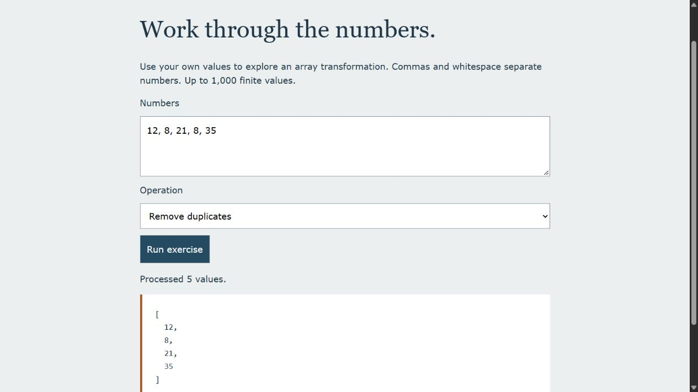

# JavaScript fundamentals: part 2

JavaScript learning notes with a small interactive number exercise. Enter your own values to compare a summary, unique values, numeric sorting and a map operation.

[Open the live demo](https://ismaeelakin.github.io/fundamental_js_part_2/)

## Try the exercise

Run `python -m http.server 8093 --bind 127.0.0.1` from this repository. Open <http://127.0.0.1:8093/starter/>.

The page loads only `practice.js`. The original notes in `starter/script.js` remain available for reading and are not executed on page load. The companion accepts up to 1,000 finite numbers and reports invalid input and arithmetic overflow.

## Structure

Input text is split into tokens, converted to numbers and validated before an array operation runs. Results are rendered as text. There are no packages, network calls, accounts or saved data.

## Review

Try `3, 1, 3, -2`, switch among operations, then try empty input, `hello` and very large numbers. Sorting works on a copy; duplicate removal preserves first occurrence order. JavaScript uses floating-point numbers, so this is not a precision arithmetic tool.

## Status

This is learning work, not a production application or evidence of commercial experience. The main portfolio projects are [Rowcraft](https://github.com/ismaeelakin/rowcraft), [Dispatch Ledger](https://github.com/ismaeelakin/dispatch-ledger) and [RelayBox](https://github.com/ismaeelakin/relaybox).
