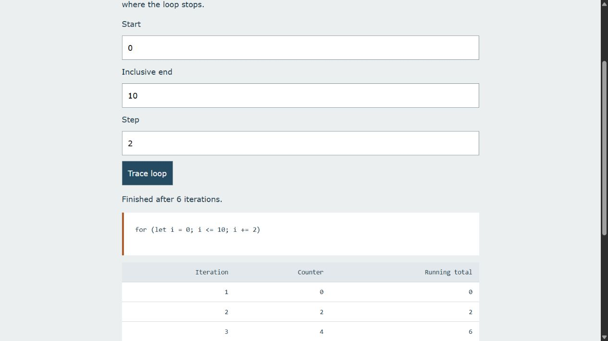
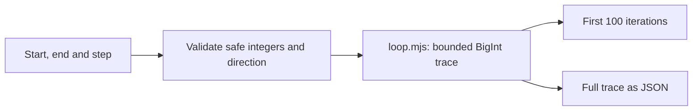

# Loop Trace

A JavaScript learning tool that shows each iteration of an integer loop. Enter your own start, inclusive end and step, inspect the counter and exact running total, and download the trace.

[Open Loop Trace](https://ismaeelakin.github.io/fundamental_js_part_2/)



## Features

- Ascending and descending integer loops with inclusive end conditions.
- Clear errors for a zero step, the wrong direction or unsafe integer inputs.
- A 1,000-iteration guard, with explicit reporting when a trace is incomplete.
- BigInt running totals and next-counter values, including sums beyond Number's safe range.
- A table of the first 100 iterations and a JSON download of the full bounded trace.

## Tech stack

HTML, CSS and browser JavaScript modules. Node.js runs the tests. No packages, accounts or external services are required.

## Setup

```sh
python -m http.server 8093 --bind 127.0.0.1
```

Open <http://127.0.0.1:8093/starter/>. A static server is needed for ES modules. The live deployment contains the same browser source.

## Architecture



`loop.mjs` contains the pure trace function. `practice.js` handles events, text rendering and file download. The app traces a fixed loop contract; it never evaluates pasted JavaScript. Truncation clears neither the recorded iterations nor the distinction between a completed and incomplete trace.

## Verify

```sh
node --test test/loop.test.mjs
```

Seven tests cover inclusive bounds, descending steps, equal endpoints, invalid directions, iteration limits, unsafe inputs and exact large totals.

Try `0 → 10` with step `2`, then `5 → 0` with step `-2`. A zero step must report an error. `0 → 5000` with step `1` must stop at the guard and report that the loop would continue.

## Learning history and limits

This repository began as JavaScript functions and loop exercises. The notes remain in `starter/script.js` for reading and are not loaded by the app. Two original loop mistakes were corrected: a semicolon that detached a loop body and a shadowed counter variable.

Inputs must be safe integers, although totals use BigInt internally. This is a teaching tool for one loop shape, not a general JavaScript debugger. The [part 1 companion](https://github.com/ismaeelakin/js-fundamentals) focuses on array operations instead.
